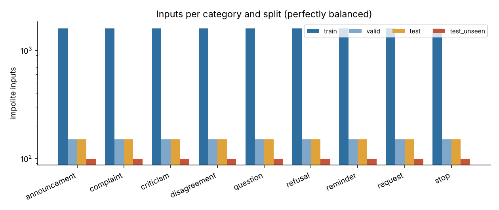
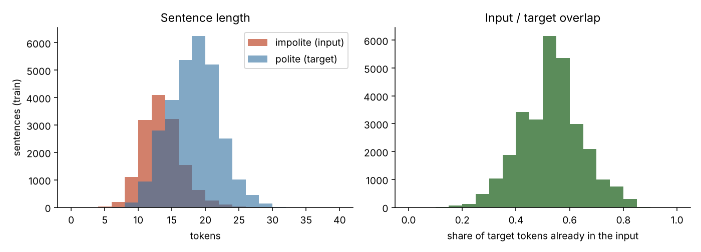
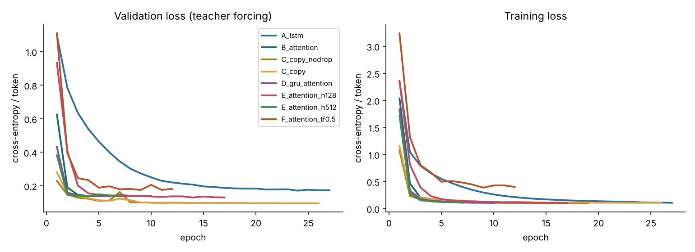
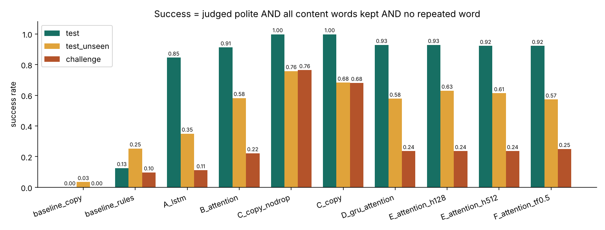

# Politely — Rewriting Impolite Sentences Politely with an Encoder–Decoder Built from Scratch

*NLP course project — Text generation with encoder–decoder architectures*

Every number in this report was produced by the code in this repository and can be found in
`reports/results.json`, `reports/dataset_stats.json`, `reports/vocab_stats.json` and
`experiments/<model>/`. Nothing was estimated or copied from elsewhere.

---

## 1. Introduction

### 1.1 Task

**Politeness transfer**: given a blunt, impatient or dismissive English sentence, generate a
polite sentence that says *the same thing*.

| Input (impolite) | Target (polite) |
|---|---|
| Send me the report now. | Could you please send me the report as soon as possible? |
| Your poster is full of typos. | Thank you for the poster. I think it has a few typos, though. |
| Stop guessing, the store closes at 6 pm. | If I remember correctly, the store closes at 6 pm. |

### 1.2 Motivation

Rephrasing a message so that it is received well is something people do every day (emails,
customer service, team chats). It is also an ideal problem to study an encoder–decoder: the
output depends on the whole input (who, what, when must be kept), but its *form* must change
(imperative → question, criticism → softened feedback, refusal → apology). A model that simply
copies the input fails, and a model that ignores the input and writes a generic polite sentence
fails too.

### 1.3 Problem formulation

Input: a sequence of tokens `x = (x₁ … xₙ)`. Output: a sequence `y = (y₁ … y_m)` ending with
`<EOS>`. The model learns `P(y | x) = Π_t P(y_t | y_<t, x)` and is trained to minimise the
token-level cross-entropy on (impolite, polite) pairs. It is a **sequence-to-sequence
paraphrase / style-transfer** problem. A good output must satisfy three conditions at the same
time: (1) be polite, (2) keep all the content of the input, (3) be fluent. Section 7 measures
each one separately.

---

## 2. Related concepts

**Text style transfer** changes an attribute of a text (formality, sentiment, politeness)
while keeping its content. With parallel data (pairs of sentences), it is treated like
translation from "impolite English" to "polite English".

**Encoder–decoder (seq2seq).** An *encoder* reads the input and turns it into vectors; a
*decoder* generates the output one token at a time, conditioned on these vectors and on the
tokens it has already produced (Sutskever et al., 2014; Cho et al., 2014).

**Recurrent cells.** The LSTM (and the lighter GRU) keep a hidden state updated at every token;
their gates let information survive across many steps, which plain RNNs cannot do because of
vanishing gradients.

**Attention** (Bahdanau et al., 2015). Without attention, the whole input must fit into one
fixed-size vector. Attention lets the decoder look back at *every* encoder state at each step
and build a context vector focused on the words that matter for the next output word.

**Copy mechanism** (pointer-generator, See et al., 2017). At each step the model mixes two
distributions: generating a word from the vocabulary, or copying a word of the input (with the
attention weights as copy probabilities). It is useful whenever the output repeats input words —
exactly the case here, where names, objects, numbers and dates must be carried over.

---

## 3. Dataset

### 3.1 Source

Public parallel corpora close to this task (detoxification corpora such as ParaDetox) are built
from offensive messages and contain insults and swear words, which this project wants to
exclude. The dataset was therefore **built for the project**: a reproducible program,
`src/politely/generate_dataset.py`, assembles sentence pairs from building blocks written by
hand in `src/politely/resources.py`. This gives full control over the content: balanced
categories, the same facts on both sides of a pair, no offensive language, and test sets with
phrasings never seen in training. The building blocks are:

* **9 categories** of everyday messages, balanced: request, reminder, refusal, criticism,
  complaint, disagreement, question, stop (asking someone to stop a behaviour), announcement;
* **slot values** (people, documents, objects, rooms, events, times, bills, facilities,
  services and their problems, facts, questions…) — about 1,800 distinct words;
* per category, **12 impolite phrasings** (templates) and **6 polite phrasings**;
* optional **explanation sentences** ("We are already late.") that must be carried over.

For one input, the generator draws a *content* (e.g. action = *close*, object = *the kitchen
window*, time = *now*, reason = *It's raining outside*), realises it with one impolite
phrasing, and with three different polite phrasings. Rudeness is carried by **tone only**
(orders, impatience, dismissive remarks, harsh judgements of a piece of work); every sentence is
checked against a list of banned words (insults, swear words, hateful terms) and none appears.

### 3.2 Improving the dataset (version 1 → version 2)

The dataset was improved after a first round of experiments. The first version (v1) had two
problems:

* **errors and incoherent pairs** — some combinations of building blocks produced sentences
  that make no sense or are ungrammatical: *"Move your car out of the library"*, *"Give a talk at
  the football match"*, or *"You were supposed to call Sarah back. **Call it** today."* (the
  template "<verb> it" does not work with phrasal verbs or with a person as object);
* **a vocabulary that was too narrow** — office life only, 1,371 words.

The models trained on v1 were very good on v1's own test set but very bad on sentences written
by hand (0 %–1 % success, section 7.4): they recognised known word combinations instead of
learning to *keep whatever the input says*.

**Version 2** (the final one) keeps the same design, categories and phrasings, and improves the
content: incoherent combinations were removed (no cars in libraries; criticism contexts that fit
the kind of work — food, art, music, documents), templates such as "<verb> it" are no longer
combined with actions where they are ungrammatical, and the vocabulary was widened
to everyday life — home, shopping, transport, school, leisure, phrasal verbs (*turn the music
down*), explanation sentences — with 14,400 training inputs instead of 10,800. The v1 results are
kept in `archive_v1/` and compared in section 7.4.

### 3.3 Fields and files

`data/politeness_dataset.csv` (and the same rows split into `train.csv`, `valid.csv`,
`test.csv`, `test_unseen.csv`):

| Column | Meaning |
|---|---|
| `id` | input id (`req-train-0042`); the references of one input share it |
| `split` | train / valid / test / test_unseen |
| `category` | one of the 9 categories |
| `template_id` | impolite phrasing used (`req_02`); `*_10…12` are held out |
| `ref_index` | which polite reference (0, 1, 2) |
| `impolite` | the input |
| `polite` | a reference output |

`data/challenge.csv` contains **72 pairs written by hand** (8 per category), independently of
the generator, with other words and structures ("Turn the music down.", "Where's the bathroom?",
"Prices go up next month, like it or not.").

### 3.4 Statistics (`reports/dataset_stats.json`)

| Split | Inputs | Pairs | Refs / input | Impolite phrasings | Mean length in / out (tokens) |
|---|---|---|---|---|---|
| train | 14,400 | 28,800 | 2 | 81 (seen) | 13.1 / 17.8 |
| valid | 1,350 | 4,050 | 3 | 81 (seen) | 13.3 / 18.0 |
| test | 1,350 | 4,050 | 3 | 81 (seen) | 13.2 / 18.0 |
| test_unseen | 900 | 2,700 | 3 | 27 (**never seen**) | 14.1 / 17.9 |
| challenge | 72 | 72 | 1 | hand-written | 8.0 / 11.9 |

* Every category has exactly 1,600 / 150 / 150 / 100 inputs in train / valid / test /
  test_unseen (figure `dataset_categories.png`).
* **0** input shared between two splits, **0** duplicate pair, **0** pair where output = input.
* 52.8 % of the target tokens already appear in the input (figure `dataset_lengths_overlap.png`):
  half of the job is copying, half is rewriting.
* Limitation: distinct-3 (share of distinct word trigrams) is 0.18 in train — the phrasings
  come from a finite set of templates.

### 3.5 Split

The split is made **by content**, not by pair: a content (action + object + time + reason…)
used in one split is never used in another, and all references of one input stay in the same
split. A test sentence is therefore never a training sentence with a different wording.
Three test sets measure three levels of generalisation:

1. **test** — new content, phrasings seen in training;
2. **test_unseen** — new content *and* impolite phrasings never seen in training (3 of the 12
   phrasings of each category are reserved for it);
3. **challenge** — hand-written sentences, outside the generator.

Validation is used for every choice (early stopping, model, decoding); the test sets are
measured once, at the end.

---

## 4. Preprocessing (`preprocessing.py`, `vocab.py`, `dataset.py`)

| Step | What | Why, for this task |
|---|---|---|
| Normalisation | Unicode NFKC, curly quotes → straight quotes, spaces collapsed | the same word must always give the same token (`don’t` = `don't`) |
| Lowercasing | yes | politeness does not depend on case; halves the number of word forms. The interface restores the user's capitals for display (`TV`, `Sarah`). |
| Punctuation | each mark is a separate token | `?` versus `.` carries meaning here: a polite request is usually a question |
| Tokenisation | regex `\w+(?:'\w+)?` or one punctuation mark; contractions stay one token (`don't`, `i'm`) | word level is enough for short sentences and keeps sequences short (13 tokens on average) |
| Vocabulary | built on the **training split only**; words seen at least twice | rare words would get untrained embeddings; building on train only avoids leakage |
| Special tokens | `<PAD>`=0, `<SOS>`=1, `<EOS>`=2, `<UNK>`=3 | padding, start and end of generation, unknown words |
| Padding | batches are padded to the longest sentence with `<PAD>`; the encoder uses packed sequences and attention uses a mask, so padding is never read | variable-length sentences in one tensor |
| Truncation | inputs and targets cut at 40 tokens (the longest sentence has 31) | bounds memory and decoding time; also the limit enforced by the interface |
| Unknown words | mapped to `<UNK>`; the copy model gives each unknown input word a temporary id so it can still be copied | names, numbers and rare objects are frequent here |

**Vocabulary size: 1,805** (1,801 words + 4 special tokens), shared by the encoder and the
decoder because input and output are the same language. Proportion of unknown tokens
(`reports/vocab_stats.json`): 0 % in train, 0.5 % in valid/test, 4.7 % in test_unseen, 11.5 %
in challenge (19.3 % with the v1 vocabulary).

**Numerical representation.** `"Close the window now."` → `[close, the, window, now, .]` →
`[ids…, EOS]` → each id is turned into a **128-dimensional embedding** by `nn.Embedding`
(trained from scratch, `padding_idx=0`). The decoder input is `<SOS>` + target, the training
label is target + `<EOS>`.

---

## 5. Proposed architecture (`models.py`)

### 5.1 Encoder

`Embedding(1805, 128)` → dropout 0.3 → **LSTM, 1 layer, hidden size 256, unidirectional**.
It returns one hidden state per input word (`[B, n, 256]`, used by attention) and the final
state `(h_n, c_n)`, which **initialises the decoder**. (A bidirectional option exists in the
code, with a linear "bridge" that merges the two directions.)

### 5.2 Decoder (one step)

At step *t* the decoder receives the **previous token** (the true one during training with
teacher forcing, its own prediction at inference) and its previous state:

1. `e = Embedding(y_{t-1})` (same embedding matrix as the encoder);
2. attention: context vector `c_t` (5.3);
3. `s_t = LSTM([e ; c_t], s_{t-1})`;
4. output layer: `[s_t ; c_t ; e]` → linear 128 → dropout → linear 1805 = logits
   (factorised through 128 dimensions to save parameters);
5. `softmax` → probability of every vocabulary word.

Generation starts with `<SOS>` and **stops when `<EOS>` is produced** or after 40 tokens.

### 5.3 Attention (Bahdanau, additive)

*Why:* without attention (model A) the decoder only sees the final encoder state: one vector of
256 numbers must contain every detail of the sentence (the person, the object, the day…). With
13-token inputs full of details, the decoder forgets or mixes them up (section 8).

*How:* for each encoder state `h_j` and the current decoder state `s`:

`score_j = vᵀ tanh(W_enc h_j + W_dec s)` (attention dimension 128)
→ padding positions are masked (score = −∞)
→ `α = softmax(score)` (weights summing to 1)
→ **context** `c_t = Σ_j α_j h_j`, concatenated to the decoder input and to the output layer.

The weights `α` are what the interface draws as a heat map.

### 5.4 Copy mechanism (pointer-generator)

A switch `p_gen = σ(w · [c_t ; s_t ; e] + b)` decides between generating and copying:

`P(w) = p_gen · P_vocab(w) + (1 − p_gen) · Σ_{j : x_j = w} α_j`

Unknown input words receive temporary ids beyond the vocabulary, so a word never seen in
training (*Grzegorz*, *4721*, *zucchini*) can still be produced. The training targets use the
same extended ids, so the loss teaches the model when to copy.

**Word dropout** (`unk_dropout = 0.1`, our addition for v2): during training, 10 % of the input
words are shown to the encoder as `<UNK>` while their real id is kept for copying. Without it,
the training data contain almost no unknown words (0 % of train tokens), so the copy switch
never learns what to do with them; with it, the model learns "if I cannot read a word, copy it".
Model `C_copy_nodrop` is the ablation.

### 5.5 Models compared and number of parameters

| Model | Change | Parameters |
|---|---|---|
| **A_lstm** | baseline: LSTM encoder–decoder, no attention | 1,303,693 |
| **B_attention** | A + Bahdanau attention | 1,664,397 |
| **C_copy** | B + copy mechanism + word dropout 0.1 | 1,665,038 |
| C_copy_nodrop | C without word dropout (ablation) | 1,665,038 |
| D_gru_attention | B with GRU cells instead of LSTM | 1,401,229 |
| E_attention_h128 | B with hidden size 128 | 875,917 |
| E_attention_h512 | B with hidden size 512 | 4,421,005 |
| F_attention_tf0.5 | B trained with teacher forcing ratio 0.5 | 1,664,397 |

Breakdown for B: shared embedding 231,040 · encoder LSTM 395,264 · attention 65,792 · decoder
LSTM 657,408 · output layer 314,893. The copy switch adds 641 parameters.

---

## 6. Training (`train.py`, `config.py`)

| Setting | Value | Reason |
|---|---|---|
| Loss | token-level cross-entropy (NLL of the log-probabilities), `<PAD>` ignored | standard objective of sequence generation |
| Optimizer | Adam, learning rate 1e-3 | robust default for RNNs |
| LR schedule | ×0.5 when the validation loss does not improve for 1 epoch | finer steps near convergence |
| Batch size | 64 (shuffled each epoch, fixed seed 42) | |
| Epochs | at most 30, **early stopping** after 3 epochs without validation improvement; the best checkpoint is kept | prevents overfitting, saves time |
| Embedding / hidden | 128 / 256 (E: 128 and 512) | small vocabulary and short sentences |
| Layers | 1 | enough for 13-token sentences (see E for capacity) |
| Dropout | 0.3 on embeddings and before the output layer | regularisation |
| Gradient clipping | global norm 1.0 | prevents exploding gradients in RNNs |
| Teacher forcing | ratio 1.0 (F: 0.5) | see below |
| Hardware | 2-core CPU, no GPU | |

**Teacher forcing.** During training the decoder normally receives the *true* previous word
(ratio 1.0): training is fast and stable. With ratio 0.5 (model F), at each step a coin decides
whether the decoder receives the true word or its own prediction, which exposes it to its own
mistakes as at inference time ("exposure bias"). Validation loss is always computed with full
teacher forcing so that all models are compared on the same basis.

**Sanity check.** Before every full training, each architecture had to memorise 40 pairs
(`--overfit 40`, no dropout, 60 epochs). All eight configurations did (logs in
`experiments/sanity_*`): the loss of B fell from 7.49 to 0.07, and every model ended between
0.05 and 0.17 with a token accuracy of 0.96–0.97 (it cannot reach 1.0 because each input has two different polite
references). This proves that the forward pass, the loss and the masking are correct.

---

## 7. Experimental results

### 7.1 Metrics and why

| Metric | What it measures | Why it is needed here |
|---|---|---|
| **BLEU** (multi-reference, 1–4-grams, written by hand and checked equal to `sacrebleu`) | n-gram overlap with the 3 references | standard for generation; but many correct polite phrasings exist, so BLEU underestimates good outputs |
| **chrF** | character n-gram F-score | more tolerant of small variations (*send / sending*) |
| **Exact match** | output identical to one reference | strict; low by nature (6 polite phrasings per category) |
| **Content kept** | share of the input's content words (present in the input and in every reference, compared after light stemming so that *close/closing* match) found in the output | a polite sentence that drops "Friday" or "Sarah" is wrong |
| **Polite rate** | share of outputs that our politeness classifier judges polite (P ≥ 0.5) | the style must actually change |
| **Success** | polite **and** all content words kept **and** no repeated word | one number for "usable rewrite" — the main automatic metric |
| **Repetitions** | a word immediately repeated ("the the") | typical seq2seq failure |
| Token accuracy, perplexity | teacher-forced, on the reference pairs | diagnostics of the language model, not of the generated text |
| **Human evaluation** | acceptable / partial / failed, judged sentence by sentence | the automatic metrics cannot judge grammar and meaning (section 7.5) |

The **politeness classifier** (`politeness.py`) is a logistic regression on word unigrams and
bigrams written from scratch in NumPy (12,680 features), trained on the training split only. It
recognises 100 % of the valid/test sentences, 98.3 % (balanced) of test_unseen and 88.9 % of the
challenge set (it misses 22 % of the hand-written *polite* sentences, which use rarer markers).
All neural models reach a polite rate of ≈ 1.0: they always produce a polite *frame*. The
differences between models are therefore in **content** and **fluency**.

### 7.2 Learning curves (figure `learning_curves.png`)

| Model | Best epoch / epochs run | Best valid loss | Valid perplexity | Training time |
|---|---|---|---|---|
| A_lstm | 24 / 27 | 0.171 | 1.19 | 27.5 min |
| B_attention | 5 / 8 | 0.138 | 1.15 | 11.9 min |
| C_copy_nodrop (final) | 16 / 19 | 0.097 | 1.10 | 53.7 min* |
| C_copy (word dropout) | 26 / 26 | 0.096 | 1.10 | 39.5 min |
| D_gru_attention | 7 / 10 | 0.137 | 1.15 | 11.9 min |
| E_attention_h128 | 14 / 17 | 0.130 | 1.14 | 16.9 min |
| E_attention_h512 | 4 / 7 | 0.137 | 1.15 | 21.2 min |
| F_attention_tf0.5 | 9 / 12 | 0.175 | 1.19 | 17.9 min |

\* Its first epoch ran at the same time as other jobs (1,409 s instead of ~90 s); the other 18 epochs took about 28 minutes.

* **No overfitting in the usual sense:** the validation loss stays at or below the training loss
  (dropout is only active in training) and early stopping kept the best epoch. Larger models
  (E_h512) reach their best point earlier and then stall, a first sign that capacity is not the
  bottleneck.
* **A learns much more slowly** (24 epochs) than the attention models (5–16): squeezing the
  sentence into one vector is hard.
* The loss cannot reach 0: each input has two different references in training, so the best
  possible model hesitates between them (the sanity check shows the same ceiling, ≈ 0.97 token
  accuracy).
* **F (teacher forcing 0.5)** has a higher training loss by construction (it is fed its own
  mistakes) and a higher validation loss.

### 7.3 Quantitative evaluation and baseline comparison

Success rate (greedy decoding unless stated; full tables with all metrics in
`reports/results.md`):

| System | valid | **test** | **test_unseen** | **challenge** | BLEU test | Content kept (test / unseen / challenge) |
|---|---|---|---|---|---|---|
| Copy baseline | 0.000 | 0.000 | 0.034 | 0.000 | 47.5 | 1.000 / 1.000 / 1.000 |
| Rule-based baseline | 0.128 | 0.125 | 0.253 | 0.097 | 48.2 | 1.000 / 1.000 / 1.000 |
| A_lstm (no attention) | 0.862 | 0.845 | 0.350 | 0.111 | 74.2 | 0.961 / 0.584 / 0.343 |
| B_attention | 0.921 | 0.912 | 0.582 | 0.222 | 77.2 | 0.983 / 0.851 / 0.506 |
| D_gru_attention | 0.928 | 0.928 | 0.578 | 0.236 | 77.3 | 0.987 / 0.845 / 0.561 |
| E_attention_h128 | 0.930 | 0.928 | 0.630 | 0.236 | 77.1 | 0.987 / 0.875 / 0.516 |
| E_attention_h512 | 0.923 | 0.921 | 0.613 | 0.236 | 77.2 | 0.985 / 0.874 / 0.499 |
| F_attention_tf0.5 | 0.924 | 0.921 | 0.572 | 0.250 | 77.2 | 0.985 / 0.846 / 0.527 |
| C_copy (copy + word dropout) | 0.996 | 0.998 | 0.682 | 0.681 | 78.2 | 0.999 / 0.868 / 0.889 |
| C_copy_nodrop (copy) | 0.998 | 0.998 | 0.758 | 0.764 | 78.6 | 0.999 / 0.913 / 0.923 |
| **C_copy_nodrop + beam 5 (final)** | **1.000** | **0.999** | **0.787** | **0.764** | 77.3 | 1.000 / 0.924 / 0.926 |

**Choice of the final system.** Every choice was made on the validation set. Among the models,
C_copy_nodrop has the best validation success (0.998); among its decoding strategies (table
below), beam search with 5 beams is the best (1.000). The test sets were then measured once.
*Caveat:* the validation set is almost saturated (0.996–1.000 for all copy variants), so it
separates these variants only weakly; the generalisation sets tell them apart much more clearly
— they happen to agree with the validation choice.

**Decoding strategies** (C_copy_nodrop, validation, figure `decoding.png`):

| Decoding | Success | BLEU | chrF | Exact match | Mean length | Time for 1,350 sentences |
|---|---|---|---|---|---|---|
| greedy | 0.998 | 78.46 | 83.8 | 0.512 | 17.7 | 1 s (batched) |
| beam 3 | 0.999 | 78.15 | 83.8 | 0.518 | 18.1 | 27 s |
| **beam 5** | **1.000** | 78.53 | 84.2 | 0.527 | 18.3 | 29 s |
| sampling T = 0.7 | 0.999 | 79.34 | 84.0 | 0.522 | 17.9 | 2.5 s |
| top-k = 5 (T = 1) | 0.998 | 78.62 | 83.6 | 0.511 | 17.9 | 2.7 s |

Differences are small on this easy set. Beam search never drops content (content kept 1.000)
because it compares whole sentences; sampling gives more varied phrasings at a small risk
(top-k at T = 1 makes the most mistakes). On test_unseen, beam 5 also beats greedy
(0.787 vs 0.758).

### 7.4 What each change brought (answers to the required questions)

**Does the model learn the task?** Yes. On new content with known phrasings (test), every
neural model is far above both baselines (0.85–1.00 vs 0.00–0.13). The baselines show why the
task is not trivial: copying keeps 100 % of the content but is never polite; deleting rude
markers and adding "please" is judged polite only 13 % of the time.

**Does attention improve the results?** Clearly. A → B: success 0.845 → 0.912 on test,
0.350 → 0.582 on test_unseen, 0.111 → 0.222 on challenge; content kept on test_unseen
0.584 → 0.851; validation loss 0.171 → 0.138, reached in 5 epochs instead of 24. Without
attention, the model must rebuild every detail from one vector and replaces rare details with
frequent ones (section 8).

**Does the copy mechanism improve the results?** It is the largest single gain: B → C on the
hand-written challenge set, success 0.222 → 0.764 and content kept 0.506 → 0.923. Names,
numbers and objects can now be copied instead of being generated from the vocabulary. The
attention maps show the copy as an almost perfect diagonal on the content part of the sentence
(figures `attention_*.png`).

**Does increasing model complexity improve performance?** No. Hidden size 128 / 256 / 512
(875 k / 1.66 M / 4.42 M parameters) give the same test success (0.928 / 0.912 / 0.921) and
similar generalisation (0.630 / 0.582 / 0.613 on test_unseen). The largest model stops
improving after 4 epochs. Errors come from *what the model has seen* (data) and *how it can
produce words* (copy), not from capacity. The GRU (D, 16 % fewer parameters) is as good as the
LSTM.

**Teacher forcing.** Training on its own predictions half of the time (F) did not help:
success 0.921 on test (B: 0.912), 0.572 on test_unseen (B: 0.582), and a higher validation loss.
With short sentences and a strong signal, exposure bias is not the main problem here.

**Word dropout — a hypothesis that was not confirmed.** We expected that hiding 10 % of the
input words behind `<UNK>` would teach the copy mechanism to copy unknown words. The opposite
happened: C_copy (with word dropout) is worse than C_copy_nodrop on test_unseen (0.682 vs
0.758) and challenge (0.681 vs 0.764) and repeats words more often. A likely explanation: the
pointer-generator already copies unknown words without it, because their extended id makes them
copyable, while hiding *known* words removes the information the model needs to decide what
kind of sentence it is rewriting. We kept the ablation in the report and chose the model without
word dropout.

**Effect of the dataset (v1 → v2).** The challenge set is the only test set identical in both
versions (rescored with the same metric):

| | v1 dataset (office only, 1,371 words) | v2 dataset (final, 1,805 words) |
|---|---|---|
| A_lstm, challenge success / content kept | 0.014 / 0.090 | 0.111 / 0.343 |
| B_attention, challenge success / content kept | 0.000 / 0.191 | 0.222 / 0.506 |
| Unknown tokens in challenge inputs | 19.3 % | 11.5 % |

Broadening the world of the data mattered as much as the architecture.

### 7.5 Human evaluation: how far can the automatic metric be trusted?

"Success" checks politeness *markers* and *content words*, not grammar or meaning. To measure
the gap, every output of the final system on the challenge set (72), and random samples of 40
outputs on test and on test_unseen, were labelled **acceptable** (polite, same meaning,
grammatical), **partial** (meaning recoverable but ungrammatical, a detail lost, or tone not
fully softened) or **failed** (meaning changed or garbled). The labels are in
`reports/human_eval_*.csv` and the summary in `reports/human_eval_summary.json`.
*Note: the labels were produced with the help of the AI assistant used for this project and
should be re-checked by the student before submission.*

| Set (final system) | Automatic success | Human: acceptable | partial | failed |
|---|---|---|---|---|
| test (40 random) | 0.975 | **0.975** | 0.025 | 0.000 |
| test_unseen (40 random) | 0.775 | **0.375** | 0.275 | 0.350 |
| challenge (all 72) | 0.764 | **0.528** | 0.167 | 0.306 |
| challenge, B_attention (all 72) | 0.222 | 0.167 | 0.056 | 0.778 |

* On sentences like the training data, the automatic metric is reliable (100 % agreement).
* Outside it, the automatic metric is **too optimistic**: it accepts outputs that contain the
  right words in the wrong grammar ("could you **booked** the restaurant") or with a reversed
  meaning ("Would it be possible for you to lend **you** any more money?").
* The honest headline figure for free-form input is therefore **about half of the rewrites are
  fully acceptable** (and 70 % are at least understandable) — compared with 17 % for the
  attention model without copy.

Acceptable rate on the challenge set by category: request 100 %, stop 88 %, disagreement 63 %,
complaint 50 %, question 50 %, reminder 38 %, criticism 38 %, announcement 38 %, refusal 13 %.

---

## 8. Generated examples

### 8.1 Successful examples (final system)

| Set | Input | Reference (one of 3) | Generated |
|---|---|---|---|
| test | I told you to put the bottles back in the lab. Do it this afternoon. The lab is a mess. | Would it be possible for you to put the bottles back in the lab this afternoon? The lab is a mess. | Could I ask you to put the bottles back in the lab this afternoon? Thank you! The lab is a mess. |
| test | Again! The package number 7690 was sent to the wrong address last week. | I hope you can help: my package number 7690 was sent to the wrong address last week. Thank you in advance. | Hi, I'm writing because my package number 7690 was sent to the wrong address last week. I would appreciate your help. |
| test_unseen | How many times? Stop borrowing my bags without asking. I have mentioned it twice already. | — | Could you please avoid borrowing my bags without asking? I have mentioned it twice already. |
| challenge | Give me the keys to the storage room. | Could you please give me the keys to the storage room? | Could I ask you to give me the keys to the storage room? Thank you! |
| challenge | Turn the music down. | Could you please turn the music down? | Could I ask you to turn the music down? Thank you! |
| challenge | My room has no hot water. | Excuse me, there is no hot water in my room. Could you please look into it? | I'm sorry to bother you, but my room has no hot water. Could you help me? |
| challenge | You're wrong. Water boils at 100 degrees. | Actually, I think water boils at 100 degrees. | Actually, I think water boils at 100 degrees. Could you double-check? |
| challenge | Which bus goes to the airport? | Excuse me, do you know which bus goes to the airport? | Could you tell me which bus goes to the airport, please? |

The model rewrites the *frame* (order → question, criticism → "I appreciate the effort on…,
but…", complaint → "I'm sorry to bother you, but…"), removes the rude markers ("Do it", "Again!",
"How many times?") and copies the content word for word, including the number 7690 and the
explanation sentence.

### 8.2 Failure cases

| Input | Generated | What went wrong |
|---|---|---|
| I won't lend you any more money. *(challenge)* | Would it be possible for you to lend you any more money? | refusal misread as a request: **meaning reversed** |
| I waited forty minutes for my food. *(challenge)* | I appreciate the effort on the food, but it is a little overcooked. | no known frame fits, the model **invents** a criticism |
| You were supposed to pay the rent yesterday. *(challenge)* | Whenever you get a chance, could you pay the rent yesterday? | content copied, but the **tense** is not adapted |
| Where's the bathroom? *(challenge)* | I would really appreciate it if you could where's the bathroom. | contraction *where's* never seen in a question: wrong frame, ungrammatical |
| How is this acceptable? The fridge has not been working since Thursday. *(test_unseen)* | Could we take another look at the acceptable? It is a little has. | a **rude opener never seen in training** is taken for content |
| Do I have to remind you every day to lock the garden when you leave? *(test_unseen)* | Could you please remind you every day to lock the garden when you? | the rude part is copied as if it were the request |
| You still haven't lent me your remote control … I need it in ten minutes. *(test)* | … before monday? I need it in monday minutes. | a copy pointed at the wrong word (*Monday* instead of *ten*) |

The model without attention (A) fails differently: it produces fluent, polite sentences about
the **wrong content** — "Give me the keys to the storage room." → "I would really appreciate it
if you could send the newsletter to the shared folder." (v1) — because the summary vector lost
the details.

### 8.3 Qualitative analysis: why the model fails

1. **Frame selection is learned from surface cues.** The decoder chooses one of the polite
   frames it knows from a few cue words. When the cues are new ("Not interested in…", "Prices go
   up…", "How is this acceptable?"), it picks a wrong frame and then forces the content into it.
2. **Rude openers it has never seen are treated as content** and copied ("remind you every
   day"). In training, every word that is not a known rude marker is content to keep.
3. **Grammar is not re-computed.** The copy mechanism copies words as they are; the model rarely
   learned to change *booked → book*, *yesterday → soon*, or *where's → where … is*, because the
   generator's polite phrasings almost never require it.
4. **Unknown and rare words** are copied correctly most of the time (*Canberra*, *2019*,
   *voice messages*), which is precisely what the copy mechanism was added for.

Difficult inputs are therefore: refusals and announcements phrased freely (13 % and 38 %
acceptable), sentences that need a grammatical change, and rude formulas that do not appear in
the training data.

---

## 9. Discussion

### 9.1 Interpretation

* The task is learned, and the improvements come in a clear order of importance: **copy
  mechanism > attention > data diversity >> size, cell type, teacher forcing ratio**.
* The three test sets reveal three levels of generalisation: near-perfect on new content
  (0.999), good on new phrasings (0.787 automatic, 38 % fully acceptable by hand), and partial on
  free-form sentences (0.764 automatic, 53 % acceptable by hand).
* Automatic metrics agree with humans on familiar inputs and overestimate quality on unfamiliar
  ones. Reporting only the test-set score (0.999) would have been misleading.

### 9.2 Strengths

* Complete pipeline written from scratch: tokenizer, vocabulary, encoder, Bahdanau attention,
  pointer-generator copy, three decoding strategies, all metrics (BLEU checked against
  sacrebleu), politeness classifier.
* Clean experimental protocol: split by content, held-out phrasings, independent hand-written
  set, choices on validation only, baselines in every table, sanity check, human evaluation.
* Small and fast: 1.67 M parameters, under 30 minutes of CPU training (19 epochs of ~90 s),
  about 20 ms per sentence with beam search (29 s for 1,350 sentences).
* Dataset free of insults, balanced, reproducible (deterministic generator).

### 9.3 Limitations

* **Phrasings from a finite set:** 108 impolite and 54 polite templates. The model learns these
  frames very well and has trouble with other formulations — the main reason for the gap between
  test and challenge.
* **Politeness metric:** a bag-of-words classifier trained on the same data; it recognises
  politeness markers, not genuine politeness, and saturates at ≈ 1.0 for every model.
* **Content metric:** word-based; it cannot see grammar errors or meaning reversals (hence the
  human evaluation).
* **Word-level vocabulary:** morphological variants are different tokens; tense and agreement
  changes are not learned.
* **One sentence (or two short ones), English only, at most 40 tokens.**
* The human evaluation was done by one annotator with AI assistance; it should be confirmed by
  more people.

### 9.4 Possible improvements

* More varied training data: paraphrase the rude openers and polite frames (more templates, or
  real sentences collected and checked by hand); add grammar-changing examples (*booked → book*).
* Subword tokenisation (BPE) so that *booked* and *book* share pieces.
* A Transformer encoder–decoder with the same copy mechanism, for comparison.
* A coverage penalty (See et al., 2017) against repetitions, and a better politeness classifier
  trained on independent data.
* A larger human evaluation with several annotators.

---

## 10. Conclusion

**Main findings.** A small LSTM encoder–decoder written from scratch learns to rewrite impolite
sentences into polite ones. The attention mechanism and above all the copy mechanism are what
make it keep the content: success on hand-written sentences rises from 11 % (no attention) to
22 % (attention) to 76 % (copy) by the automatic metric, 17 % → 53 % fully acceptable by human
judgement. Making the model bigger, changing LSTM to GRU, or lowering teacher forcing did not
help; making the data more diverse did.

**Lessons learned.** (1) Test on data that is *really* different from training: the in-domain
test score (99.9 %) hid the real weakness. (2) An automatic metric must be checked against human
judgement. (3) Hypotheses must be tested, and can fail: word dropout made the model worse, and
we report it.

**Future work.** Collect real impolite messages (without insults) and their polite versions,
switch to subword units, and compare with a Transformer.

---

## Appendix — reproducing the numbers

`README.md` gives every command. Main files: `data/politeness_dataset.csv` (dataset),
`checkpoints/C_copy_nodrop.pt` (final model), `reports/results.md` (all metrics),
`reports/human_eval_*.csv` (human labels), `archive_v1/` (first dataset version).

## References

* Bahdanau, D., Cho, K., Bengio, Y. (2015). Neural machine translation by jointly learning to align and translate. ICLR.
* Cho, K. et al. (2014). Learning phrase representations using RNN encoder–decoder for statistical machine translation. EMNLP.
* Hochreiter, S., Schmidhuber, J. (1997). Long short-term memory. Neural Computation.
* Papineni, K. et al. (2002). BLEU: a method for automatic evaluation of machine translation. ACL.
* Popović, M. (2015). chrF: character n-gram F-score for automatic MT evaluation. WMT.
* See, A., Liu, P. J., Manning, C. D. (2017). Get to the point: summarization with pointer-generator networks. ACL.
* Sutskever, I., Vinyals, O., Le, Q. V. (2014). Sequence to sequence learning with neural networks. NeurIPS.
* Madaan, A. et al. (2020). Politeness transfer: a tag and generate approach. ACL.
